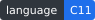
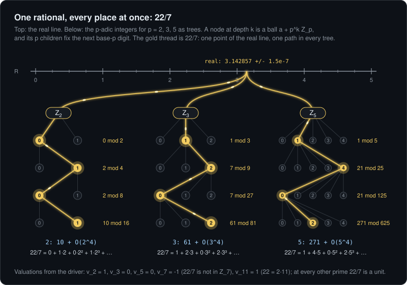
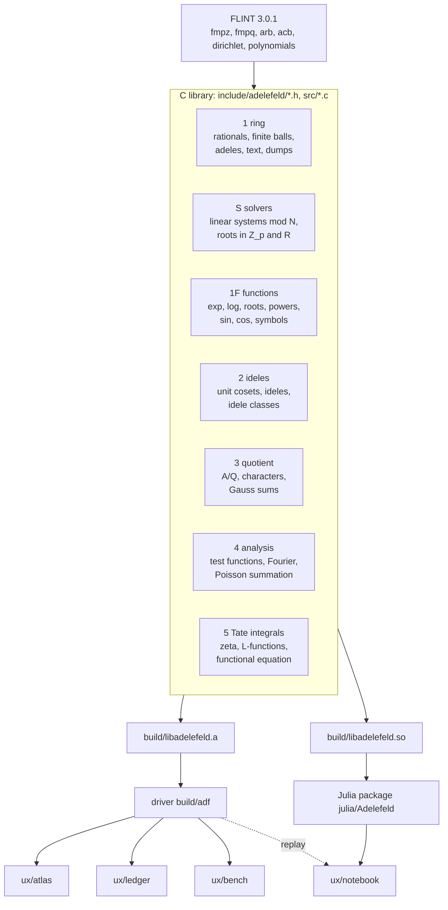

<h1 align="center">adelefeld</h1>

<p align="center">
  <b>The adeles as an ordinary number type: C on FLINT, every answer an enclosure with a status.</b>
</p>

<p align="center">
  
  
  
  
  
  
</p>

<p align="center">
  
</p>

<p align="center"><sub>
A real session of the driver <code>build/adf</code>, typed out by an SVG. Every line was produced by running the
commands in this repository; <a href="#five-minutes">Five minutes</a> shows how to run them yourself.
</sub></p>

You know how to compute with real numbers: `3.14159 ± 0.00001` is a number known by its leading digits. You may
also know modular arithmetic: "x is 146 mod 1000" is a number known by its trailing digits. **adelefeld** lets you
compute with both kinds of knowledge at once, at every prime, in one value. And it never pretends: each result is a
set that provably contains the true answer, or a named reason why there is none.

---

## What an adele is

The *places* of the rationals are the real line and one place for each prime `p`. At a prime the numbers are the
*p-adic* numbers `Q_p`: numbers written by their base-`p` digits from the right, so that `p^k` is small when `k` is
large. Among them are the *p-adic integers* `Z_p`, with no digits after the point.

An *adele* is one real number together with one p-adic number for every prime, all seen at once, with all but
finitely many of them in `Z_p`. A rational such as `22/7` is an adele: the same number at every place, a thread
through the real line and through every p-adic tree (picture below).

`Zhat`, the *profinite integers*, are the integers known modulo every `N` consistently. A *ball* `146 + 1000 Zhat`
is "an integer known modulo 1000": it fixes `146 + 2^3 Z_2` and `146 + 5^3 Z_5`, and at every other prime `q` it
says only that the number is in `Z_q` ([SPEC 2](docs/SPEC.md#2-the-picture-in-elementary-terms), lines 74 to 75
and 85).

<p align="center">
  
</p>

Each node at depth `k` is a ball `a + p^k Z_p`; its `p` children fix the next digit. The lit nodes are the driver's
answers: `project (* ; 22/7 mod 16) with 2` prints `2: 10 + O(2^4)`, the ball `10 + 2^4 Z_2`, and
`10 = 0 + 1·2 + 0·2² + 1·2³` gives the 2-adic digits `0, 1, 0, 1`. The output format is in
[`tools/adf/README.md`](tools/adf/README.md) line 260. The commands for all twelve nodes and the valuations
are in [`lanes/docs-readme/places_digits.sh`](lanes/docs-readme/places_digits.sh).

> **A subtlety worth a minute.** In the session above, `recover 146 mod 1000 with 30 with 15` answers `22/7`,
> because `7 · 146 = 1022 = 22 mod 1000`. Yet `22/7` is **not** in the adelic ball `146 + 1000 Zhat`: it is not a
> 7-adic integer (its valuation at 7 is -1). `recover` solves the classical problem "which fraction `n/d` with
> `|n| <= 30`, `0 < d <= 15` is `146` modulo 1000", a different question from "which rational lies in the ball"
> ([SPEC 9.2](docs/SPEC.md#92-rational-reconstruction): "`1/5` is `5 mod 6` in this sense, and yet `1/5` is not
> in the adelic ball `5 + 6 Zhat`"). The library keeps the two questions apart, under two names.

## Why balls and statuses

A computer cannot hold all the digits of an adele, so every inexact value is a *ball*: a set that certainly contains
the true value ([SPEC 1](docs/SPEC.md#1-goal), requirement 2). The real part is an interval `m ± r` (FLINT's `arb`);
the finite part is a ball `a + N Zhat`. Arithmetic on balls gives balls that contain every possible result:

    $ echo 'mul (3.0 +/- 0.1 ; 146 mod 1000) with 7' | build/adf
    (21 +/- 0.71 ; 1022 mod 7000)

The real radius grew from `0.1` to `0.71` (that is `0.7`, rounded outward when printed) and the modulus from `1000`
to `7000`. Nothing was dropped and nothing was invented.

When a question has no answer, or the balls are too coarse to decide it, you get a **status** instead of a guess.
The ten statuses other than `OK` (`include/adelefeld/status.h`, lines 17 to 28) fall into four classes, each drawn
with its own shape in the interfaces under `ux/` (the shapes of [`docs/ux/README.md`](docs/ux/README.md), "What
could be combined"):

<table>
<tr><th></th><th>Class</th><th>Statuses</th><th>A driver line that gives one</th></tr>
<tr>
<td></td>
<td><b>open</b>: the data given do not decide it</td>
<td><code>NOT_DETERMINED</code>, <code>UNIT_NOT_CERTIFIED</code>,
<code>NEEDS_SPLIT</code>, <code>NOT_UNIQUE</code></td>
<td><code>sin_at (* ; 0 mod 2) with 2</code> gives <code>error: NOT_DETERMINED</code>: the ball <code>2 Z_2</code>
meets both the domain <code>4 Z_2</code> of the 2-adic sine and its complement</td>
</tr>
<tr>
<td></td>
<td><b>proved no</b>: there is no answer, with a proof</td>
<td><code>DOMAIN</code>, <code>NO_SOLUTION</code>, <code>NOT_UNIT</code></td>
<td><code>roots_at -1 with 3 with 2</code> gives <code>error: DOMAIN</code>: <code>-1</code> has no square root in
<code>Q_3</code>, since the squares modulo 3 are 0 and 1</td>
</tr>
<tr>
<td></td>
<td><b>budget</b>: a resource bound was reached</td>
<td><code>LIMIT</code></td>
<td><code>roots -2 0 1 with 7 with 3000000</code> gives <code>error: LIMIT</code>: the roots of <code>X^2 - 2</code>
in <code>Z_7</code> to <code>7^3000000</code> are above the size bound</td>
</tr>
<tr>
<td></td>
<td><b>not mathematics</b>: the request itself</td>
<td><code>PARSE</code>, <code>UNSUPPORTED</code></td>
<td><code>roots 2 -1 at 5 prec 8</code> gives <code>error: PARSE</code>: not the driver's grammar</td>
</tr>
</table>

So `DOMAIN` means "proved impossible", and `NOT_DETERMINED` means "not decided from what you gave me". A program can
act on the difference.

## Five minutes

You need a C11 compiler, GNU make and **FLINT 3.0.1** with GMP (the `Makefile`, line 35; on Linux Mint 22.3 the
distribution's `libflint-dev 3.0.1-3.1build1` works). Julia is needed only for the Julia lines.

```sh
git clone https://github.com/tobiasosborne/adelefeld.git && cd adelefeld
make -j2 && make -C tools/adf        # build/libadelefeld.a, then the driver build/adf (18 s here on two cores)
```

The driver reads a script of commands, one per line, from standard input or a file. It reads the whole script
before it answers, so it has no prompt: feed it with `echo` or `printf`. Three things to try:

```console
$ echo 'project 22/7 with real 2 3 5 7' | build/adf
real: 3.142857142857142857 +/- 2.4e-19; 2: 22/7; 3: 22/7; 5: 22/7; 7: 22/7
$ printf 'prec 6\nroots_at -1 with 5 with 2\n' | build/adf
5 [2]: 14557 + O(5^6); 5 [3]: 1068 + O(5^6)
$ echo 'recover 146 mod 1000 with 30 with 15' | build/adf
22/7
```

The first shows one rational at five places. The second gives the two square roots of `-1` in `Z_5` to `5^6`. Each
is labelled by its *branch*, its residue modulo 5 (`14557 = 2 mod 5`, `1068 = 3 mod 5`), and each squares to `-1`
modulo `5^6 = 15625`. At a prime, `prec` is the number of p-adic digits. The third finds the fraction behind a
residue.

And one from the far end of the library, Tate's thesis: the zeta integral of the trivial character at `s = 2` is
`pi^(-1) Gamma(1) zeta(2) = pi/6` (the formula `pi^(-s/2) Gamma(s/2) zeta(s)` of [SPEC 8](docs/SPEC.md), lines
476 to 477, quoted from `refs/src/tate-warwick/tatesthesis_notes.txt`, lines 510 to 512):

```console
$ printf 'prec 128\ndigits 10\n%s\n' \
    'tate_integral char(q=1, n=1, s=(0) + (0)*i) with ((2) + (0)*i ; 0) with 53' | build/adf
(0.5235987756 +/- 1.8e-12) + (0 +/- 2.6e-18)*i | halfplane Re(s) > 1 | s=(2) + (0)*i
```

**From Julia.** The package loads the shared library, which a separate script builds:

```console
$ sh tests/test_exports.sh > /dev/null   # builds build/libadelefeld.so and checks its 625 exports
$ julia/Adelefeld/bin/adelefeld-julia --project=julia/Adelefeld -e 'using Adelefeld; println(Rat(1)/3)'
1/3
$ julia/Adelefeld/bin/adelefeld-julia --project=julia/Adelefeld -e \
    'using Adelefeld; println(readvalue("(3.0 +/- 0.1 ; 146 mod 1000)") * Rat(7))'
(21 +/- 0.71 ; 1022 mod 7000)
```

The launcher `adelefeld-julia` preloads the system `libgmp`, because Julia's own copy lacks a symbol that the system
FLINT needs (the comment at the top of `julia/Adelefeld/bin/adelefeld-julia` explains it). The first call also
precompiles the package, which takes a second or two.

### Four faces

Four experimental interfaces are built on the driver and the package, each as a first slice. They are static pages
that you open in a browser from your disk (`file://`); no server and no network are needed. Each folder's README is
its whole manual.

- **Notebook** ([`ux/notebook`](ux/notebook/README.md)): a notebook of Julia cells in which every value is drawn as
  a strip of places with its digits. Open [`ux/notebook/out/a_roots.html`](ux/notebook/out/a_roots.html).
- **Place Atlas** ([`ux/atlas`](ux/atlas/README.md)): the real line and the p-adic trees as a map, with the branches
  of a root drawn as paths. Open [`ux/atlas/atlas.html`](ux/atlas/atlas.html), then **Open scene JSON** on a file
  in `ux/atlas/scenes/`.
- **Ledger** ([`ux/ledger`](ux/ledger/README.md)): claims as files, sealed by rerunning the driver, refutations kept
  in view. Open [`ux/ledger/ledger.html`](ux/ledger/ledger.html).
- **Bench** ([`ux/bench`](ux/bench/README.md)): one question asked at many places, as a wall of wells with a stop
  line below which nothing is claimed. Open [`ux/bench/out/squares.html`](ux/bench/out/squares.html).

The visions behind them, and what they ask of the library, are in [`docs/ux/README.md`](docs/ux/README.md).

## What is inside



The milestones of [`docs/PLAN.md`](docs/PLAN.md) section 6, with their state from [`HANDOFF.md`](HANDOFF.md) on
2026-10-16:

| Milestone | Content | State |
|---|---|---|
| 0 | contracts: proofs of every rule, conventions, sources on disk | done; gate passed 2026-09-28 |
| 1 | the ring: rationals, finite balls, adeles, text forms, driver, policies, local backend | done, reviewed |
| R | rational reconstruction from a full ball | done, with milestone 1 (WP 1.6) |
| S | solvers: linear systems mod `N`, roots in `Z_p` and `R`, partial reconstruction | done, reviewed (optional) |
| 1F | functions: `exp`, `log`, roots and powers with branches, `sin`, `cos`, symbols | done; every WP reviewed |
| 2 | ideles: unit cosets, ideles, idele classes, division | done, reviewed |
| 3 | quotient `A/Q`, additive character, Dirichlet characters, Gauss sums | done; WP 3.1 and 3.2 reviewed |
| 4 | functions on the adeles: test functions, Fourier transform, Poisson summation | done, reviewed |
| 5 | Tate integrals, continuation, functional equation (the acceptance test) | done, reviewed |
| J | the Julia binding (`docs/api-j.md`) | in progress: J-a complete, J-b at step 1 of 4 |
| UX | four interface visions (`docs/ux/`) | first slices built and test-driven |
| 6 | the second field `F_q(T)`, then number fields | not started (after version 1) |

## Where to read next

- [`docs/GUIDE.md`](docs/GUIDE.md): the guide, a tour of the library for a new reader.
- [`docs/SPEC.md`](docs/SPEC.md): what is built, and why; section 2 is the picture in elementary terms.
- [`docs/PLAN.md`](docs/PLAN.md): the milestones and their work packages, in order.
- [`tools/adf/README.md`](tools/adf/README.md): the driver's whole manual, every command and every status.
- [`julia/Adelefeld/README.md`](julia/Adelefeld/README.md): the Julia package.
- [`docs/README.md`](docs/README.md): a map of the documents under `docs/`.
- [`docs/ux/README.md`](docs/ux/README.md): the four interface visions.
- [`CLAUDE.md`](CLAUDE.md): the rules of work (test first, ground truth on disk, thin slices).

## Details

<details>
<summary><b>The driver's commands, by group</b></summary>

Every command is `<operation> <operand> [ with <operand> ... ]`; operands are value texts such as `22/7`,
`(* ; 146 mod 1000)`, `(3.0 +/- 0.1 ; 146 mod 1000)`, `[5 mod 36]`. The full grammar and every status are in
[`tools/adf/README.md`](tools/adf/README.md).

- **values**: `show`, `type`, `dump`, `load`
- **ring**: `add`, `sub`, `mul`, `neg`, `div` (by an exact rational), `cap`
- **sets**: `equal`, `contains`, `overlaps`, `compare`
- **solvers**: `roots` (in `Z_p`), `realroots`, `recover`, `reconstruct`
- **at places**: `project`, `exp_at`, `log_at`, `sin_at`, `cos_at`, `sinh_at`, `cosh_at`, `roots_at`, `root_at`,
  `powrat_at`, `powunit_at`
- **at all places**: `root`, `exp`, `sin`, `sinh`, `cos`, `cosh`
- **ideles**: `inv`, `pow`, `powtight`, `norm`, `class`, `idele`, `hull`, `hullsimple`, `unitof`, `valuation`,
  `abs`, `Log`, `logabs`, `Log_at`, `log_abs_at`, `Log_refine`, `log_abs_refine`
- **arithmetic**: `legendre`, `jacobi`, `kronecker`, `hilbert_at`, `binom`, `binomtight`, `profpow`,
  `profpowcoarse`, `profpowfine`, `haar_volume`, `cyclo_exp_u`, `cyclo_exp_uinv`
- **characters, analysis**: `char`, `chi`, `gauss`, `char_conj`, `char_unit`, and the commands of test functions and
  Poisson summation
- **Tate's thesis**: `tate_local`, `tate_gamma`, `tate_epsilon`, `tate_vector`, `tate_integral`, `tate_continue`,
  `tate_completed`, `tate_fe`
- **settings**: `prec <bits>` (default 64; at a prime, the number of p-adic digits), `digits <n>` (default 20)

For example, the functional equation of the completed zeta function at `s = 1/2`, both sides computed and compared:

```console
$ printf 'prec 160\ndigits 10\n%s\n' \
    'tate_fe char(q=1, n=1, s=(0) + (0)*i) with ((0.5) + (0)*i ; 0) with 80' | build/adf
(-3.976966226 +/- 5e-10) + (0 +/- 2.1e-26)*i | (-3.976966226 +/- 5e-10) + (0 +/- 1.5e-27)*i | overlap=yes | s=(0.5) + (0)*i
```

</details>

<details>
<summary><b>Build notes</b></summary>

```sh
make check                          # build and run every tests/test_*.c (107 programs)
make check-all                      # also the driver, exports and Julia scripts and the tool self-tests
sh tests/test_driver.sh             # the driver cases tests/driver/*.cmd against their .out files
make clean && make check SAN=1      # address and undefined-behaviour sanitizers
make clean && make check CC=clang   # the same tests with clang
```

- FLINT 3.0.1 is linked as `-lflint -lgmp -lm`; MPFR comes in through `libflint.so` (the comment in the `Makefile`,
  lines 35 to 41).
- A few expected lines of the driver tests pin the rounding of FLINT 3.0.1 (`tools/adf/README.md`, "Two lines of the
  test depend on FLINT 3.0.1").
- The test counts in the badges are those of `HANDOFF.md` for commit `a9a3bf4` on 2026-10-16 (five suites green:
  all, sanitizers, clang, invariants, headers); the number of C test programs is `ls tests/test_*.c | wc -l`.

</details>

<details>
<summary><b>The rest of the tree</b></summary>

- `docs/PERF.md`: derived lower bounds per hardware profile, and the measurements set against them; `bench/`: the
  benchmark harness and its dated results.
- `docs/conventions.md`: canonical forms, storage invariants, status codes, the text grammar.
- `docs/proofs/`: proofs of every rule, with their review records; `docs/reviews/`: design, proof and code reviews.
- `docs/sources.md`, `refs/`: the sources on disk, with hashes.
- `docs/seams.md`: the interface tested on paper against a number field and `F_q(T)`.
- `proto/`: Python checks of the proofs; `tests/ref/`: the Python reference; `tests/golden/`: golden vectors.

</details>

<details>
<summary><b>How the pictures on this page are made</b></summary>

`python3 lanes/docs-readme/make_assets.py` (from the repository root, after the build) runs the driver and writes
`docs/assets/terminal.svg`, `docs/assets/places.svg`, the badges and the status icons. It stops if a driver output
differs from the one this page quotes. The animation is CSS inside the SVG, with no script; with animation off (for
example with "reduce motion" set) each picture shows its complete content at once.

</details>

<details>
<summary><b>Provenance and licence</b></summary>

adelefeld was spun off from `riemann-channel` (see its `notes/adeles/`). The library is written in C; Python is used
only for tests, reference oracles and proof checks; the Julia layer sits on the C interface. The rules of work
([`CLAUDE.md`](CLAUDE.md)) ask that every formula be read in a source on disk under `refs/` and cited by file and
line. Licence: [AGPL-3.0](LICENSE).

</details>
